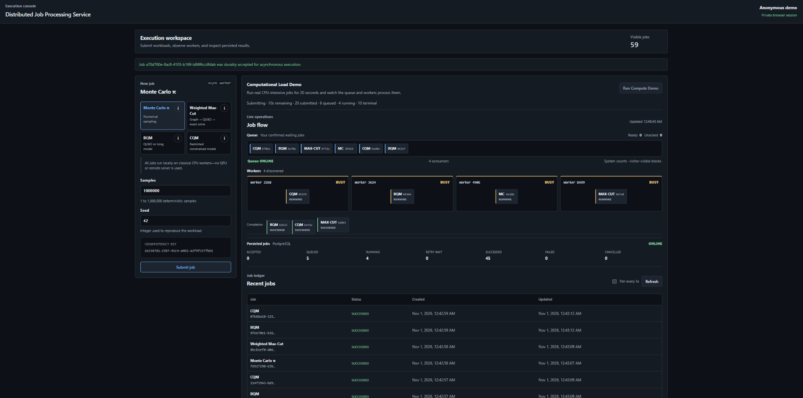
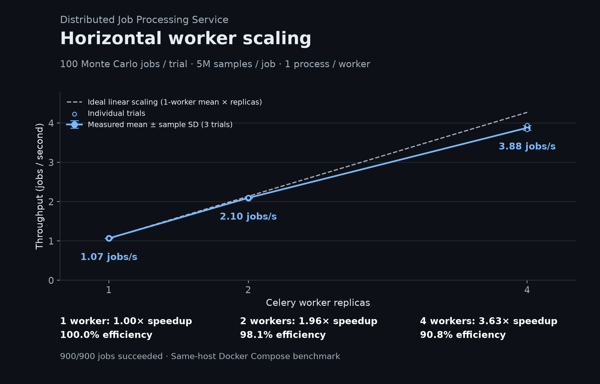

# Distributed Job Processing Service

A fault-tolerant distributed job processing system built with FastAPI, PostgreSQL, RabbitMQ, Celery, and React. It distributes CPU-intensive jobs across multiple workers, tracks execution in real time, and recovers from failures.

**Python · FastAPI · PostgreSQL · RabbitMQ · Celery · React · Docker · Kubernetes**

## Demo

[Watch Demo Video](assets/demo.mp4)




The dashboard visualizes real job submissions, RabbitMQ queue activity, worker assignments, and completed jobs.

A built-in computational demo generates workloads across four types: Monte Carlo simulation, Weighted Max-Cut, Binary Quadratic Models (BQM), and Constrained Quadratic Models (CQM). All computations run on classical CPUs.

## How It Works

```text
React Dashboard
       |
       v
   FastAPI
       |
       v
  PostgreSQL
  Jobs + Outbox
       |
       v
  Outbox Relay
       |
       v
    RabbitMQ
       |
   Shared Queue
       |
   +---+---+---+---+
   |   |   |   |   |
   v   v   v   v   v
   Celery Workers
       |
       v
  PostgreSQL
  Results + Attempts
```

The API persists each job and its outbox event in one database transaction. The relay publishes queued work to RabbitMQ, where independent Celery workers claim and execute jobs.

**Fault tolerance**

- **Transactional Outbox:** Prevents jobs from being committed without a durable publication record.
- **Idempotency:** Handles duplicate submissions and message redelivery.
- **Retry & Recovery:** Recovers abandoned jobs through execution leases and bounded retries.
- **Fencing:** Prevents stale execution attempts from overwriting valid results.

The system uses at-least-once delivery with guarded state transitions, rather than claiming exactly-once execution.

## Performance Benchmarks



Benchmarked with 100 Monte Carlo jobs per run, 5 million samples per job, and three trials per worker configuration.

| Workers | Throughput | Speedup | Efficiency |
|---|---:|---:|---:|
| 1 | 1.07 jobs/s | 1.00× | 100% |
| 2 | 2.10 jobs/s | 1.96× | 98.1% |
| 4 | **3.88 jobs/s** | **3.63×** | **90.8%** |

Scaling from one to four workers achieved **3.63× throughput speedup with 90.8% scaling efficiency**.

All **900 benchmark jobs completed successfully**, with zero submission or execution failures.

Benchmarks ran on the same desktop using Docker Compose, with one execution process per worker. Results are averages across three runs.

Error bars show sample standard deviation across the three trials, not confidence
intervals. Speedup is the ratio of mean throughputs; efficiency is speedup divided
by worker count. The dashed reference is ideal scaling from the one-worker mean.
Regenerate from the original JSON files with `python scripts/plot_worker_scaling.py`
(requires Matplotlib: `pip install matplotlib`).

## Run Locally

Requires Docker Compose, Python 3.12, Node.js, and npm.

Configure the environment:

```bash
cp .env.example .env
```

Set the local credentials and development API token in `.env`. To enable the anonymous computational demo, also configure:

```dotenv
COMPUTEGRID_DEMO_MODE_ENABLED=true
COMPUTEGRID_DEMO_SESSION_SECRET=<random secret of at least 32 characters>
```

Start the backend with four workers:

```bash
docker compose up -d --build --scale worker=4 --wait
```

Configure the frontend in `apps/web/.env.local`:

```dotenv
VITE_API_BASE_URL=http://localhost:8000
VITE_DEMO_MODE=true
```

Start the dashboard:

```bash
npm --prefix apps/web ci
npm --prefix apps/web run dev
```

Open **http://localhost:5173**.

## Testing

Run automated checks and tests:

```bash
make check
make test-all
```

The project includes unit, integration, end-to-end, and fault-injection tests. GitHub Actions runs backend and frontend CI.

The backend was also deployed and validated on a local Kubernetes cluster using kind, including worker scaling, rolling restarts, and in-flight worker failure recovery.

`make k8s-deploy` applies the manifests in `k8s/` explicitly in this order:
`namespace.yaml`, `configmap.yaml`, `postgres.yaml`, `rabbitmq.yaml`,
`migrate.yaml`, then `applications.yaml`. The Makefile creates the Secret after
configuration, waits for the dependencies to become ready, and requires migration
completion before deploying the applications. Deployment order does not depend on
filename sorting.

## Development History

For architecture decisions, engineering challenges, and
validation results, see [Engineering Roadmap](ROADMAP.md).
